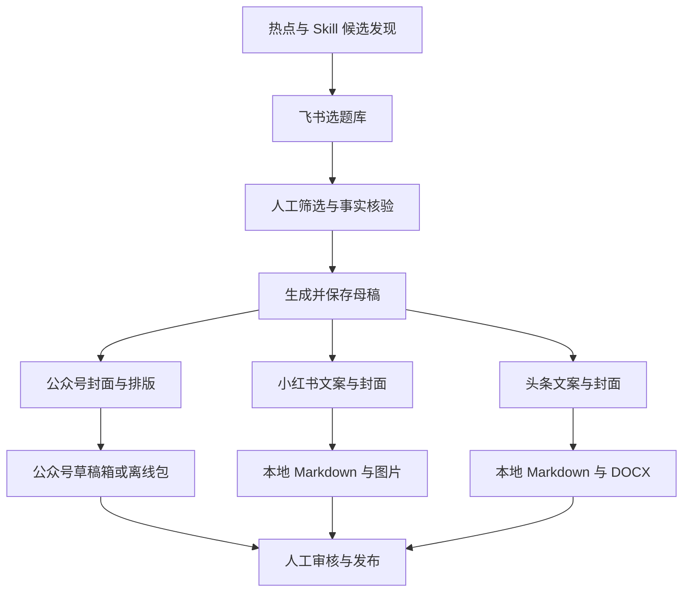

# Content Agent Flywheel

**面向中文创作者的 AI 多平台内容生产工作台。**

从热点与实用 Skill 候选发现开始，结合飞书选题库完成文章生成、封面制作、公众号排版与草稿推送，并生成小红书、今日头条本地素材。

建议 GitHub 仓库名：`content-agent-flywheel`。

> AI 负责辅助筛选、写作和格式转换，人负责事实核验与发布决策。公众号仅推送草稿箱；小红书、今日头条目前仅生成本地素材，不自动发布。

## 核心功能

| 能力 | 当前实现 |
| --- | --- |
| 热点扫描 | 从 Hacker News、Hugging Face 获取候选资讯并提炼选题 |
| Skill 候选发现 | 从 GitHub、Hacker News 扫描工具项目，结合热度与关键词生成选题 |
| 飞书选题库 | 选题入库、状态筛选、写作队列和稿件信息回填 |
| AI 文章生成 | 自动推荐或手动选择写作风格，参考历史文风并检查部分结构完整性 |
| 自动封面 | 根据文章和平台规划视觉方案，优先使用 agy CLI，失败后回退图片 API |
| 公众号排版 | 内置主题、可选 bmmd 引擎，以及外部排版 HTML 导入 |
| 公众号草稿 | 上传图片与封面、推送草稿箱并回读校验 |
| 小红书素材 | 生成平台文案、封面和 Markdown 文件 |
| 今日头条素材 | 生成平台文案、封面、Markdown，并尝试导出 DOCX |
| 离线导出 | 导出公众号 Markdown、HTML、DOCX、封面与清单 |
| 批量任务 | 记录每篇文章、每个平台的执行状态，支持重试失败项 |

**能力边界：**Skill 扫描是选题发现，不是自动安装、安全审计或真实可用性测试；热度不代表质量，生成的功能描述和数字仍需核验。文案结构检查也不等于事实检查。

## 工作流程



批量处理时，各平台独立记录结果。公众号封面失败不会阻止小红书和头条继续生成；重试失败项时会跳过已记录成功的步骤和平台。当前批量编排主要按顺序执行，并非多 Agent 并行调度系统。

## 技术组成

- **后端：**Python、FastAPI、Uvicorn。
- **前端：**原生 HTML、CSS、JavaScript。
- **内容模型：**OpenAI 兼容的 Chat Completions API。
- **封面生成：**agy CLI 优先，OpenAI 兼容图片 API 备用。
- **视觉规划：**本地 handraw-style 风格、构图与配色索引。
- **排版与导出：**Markdown、lxml、Pillow、python-docx，可选 bmmd。
- **外部服务：**飞书多维表格、微信公众号官方 API。
- **状态保存：**本地 JSON 文件与飞书记录。

## 目录结构

```text
.
├── README.md                 # 现有详细操作说明
├── PROJECT_README.md         # 项目介绍与 GitHub 展示说明
├── SKILL.md                  # 对话式内容飞轮编排规范
├── config.example.env        # 无凭据配置模板
├── config.env                # 本地私有配置，不应公开
├── scripts/                  # 配置、热点扫描、飞书与微信客户端
├── studio/
│   ├── app.py                # FastAPI 入口
│   ├── server/               # 文案、封面、排版和批量编排
│   ├── static/               # 浏览器操作台
│   ├── test_*.py             # 回归测试
│   └── requirements.txt
├── .agents/                  # 本地技能与第三方风格资源
├── style-refs/               # 用户自备历史文章，作为文风参考
└── outputs/                  # 稿件、图片、导出包和运行状态
```

## 快速开始

### 1. 准备环境

建议使用 Python 3.11，并创建当前机器对应的虚拟环境。不要直接复用其他操作系统生成的 `.venv`。

```bash
python3 -m venv .venv
source .venv/bin/activate
python -m pip install -r studio/requirements.txt
```

可选环境：

- **agy CLI：**需在运行 Studio 的用户环境中可执行，且已完成必要的登录与生图能力配置。
- **Node.js 20+：**使用 bmmd 排版时需要。
- **Google Chrome：**用于 Mermaid 图表光栅化；未安装时相关能力可能降级。

项目部分辅助功能针对 macOS，例如在 Finder 中定位文件。其他系统需要适配这些功能。

### 2. 配置服务

```bash
cp config.example.env config.env
chmod 600 config.env
```

编辑 `config.env`，填写飞书、公众号和文案模型配置。不要把真实密钥写入文档或提交到仓库。

| 配置 | 用途 |
| --- | --- |
| `FEISHU_APP_ID` / `FEISHU_APP_SECRET` | 飞书应用身份 |
| `FEISHU_APP_TOKEN` / `FEISHU_TABLE_ID` | 飞书多维表格与数据表 |
| `WECHAT_APP_ID` / `WECHAT_APP_SECRET` | 公众号草稿箱接口 |
| `WECHAT_AUTHOR` | 草稿作者名称 |
| `LLM_API_BASE` / `LLM_API_KEY` / `LLM_MODEL` | 文案生成及封面方案规划 |
| `IMAGE_GEN_API_BASE` / `IMAGE_GEN_API_KEY` | agy 失败后的图片 API 备用通道 |
| `IMAGE_MODEL` | 图片 API 使用的模型名称 |
| `IMAGE_COVER_MODEL` | 未设置 `IMAGE_MODEL` 时使用的兼容字段 |
| `IMAGE_WECHAT_COVER_SIZE` | 公众号图片 API 请求尺寸 |
| `IMAGE_COVER_SIZE` | 未设置公众号专用尺寸时使用的兼容字段 |
| `IMAGE_XHS_COVER_SIZE` / `IMAGE_JRTT_COVER_SIZE` | 小红书、头条图片 API 请求尺寸 |

环境变量优先于 `config.env`。未设置独立图片 API 地址或密钥时，备用通道仍会尝试复用文案模型配置，因此该服务需实际支持 `/images/generations`。

**agy 成功时无需调用图片 API，但文章生成和封面方案规划仍需要文案 LLM。**尺寸配置作用于图片 API；agy 依据视觉提示词生成图片，最终由程序裁切为平台成品尺寸。

### 3. 准备飞书选题表

建议按下表创建字段，名称保持一致：

| 字段 | 类型 | 作用 |
| --- | --- | --- |
| 选题标题 | 文本 | 选题名称 |
| 关键词 | 文本 | 核心检索词 |
| 内容方向 | 文本 | 新闻、教程、工具评测等分类 |
| 流量预估 | 文本 | 辅助筛选，不代表真实流量预测 |
| 状态 | 单选 | `待定`、`选中`、`已推送` |
| 备注 | 文本 | 来源、事实材料、写作约束与待验证项 |
| 文章标题 | 文本 | 生成后的标题 |
| 稿件路径 | 文本 | 本地母稿路径 |
| 入库日期 | 文本 | 日期筛选依据 |

飞书应用需具备相应多维表格权限并能访问该表。微信公众号需具备所用接口权限，且当前服务器出口 IP 应加入公众号后台白名单。详细配置见原有 `README.md`。

```bash
python scripts/feishu_btable.py verify
```

### 4. 启动操作台

```bash
python studio/app.py
```

浏览器打开：

```text
http://127.0.0.1:8765
```

默认仅监听本机。操作台不是面向公网设计的多用户服务，请勿未经鉴权与安全加固直接暴露到公网。

## 使用方式

### 浏览器工作台

1. 扫描热点或实用 Skill 候选，也可手动导入选题。
2. 在飞书或操作台审核来源、数字和功能描述，选中值得写的主题。
3. 选择写作风格，生成并编辑母稿。
4. 生成封面、预览公众号排版，或生成其他平台素材。
5. 推送公众号草稿箱，或导出本地素材后到平台官方后台操作。

当前扫描入库按钮会直接写入飞书，并不是先展示候选确认页。不要反复点击来刷新结果；目前仍需留意重复选题。

### 对话式编排

项目根目录的 `SKILL.md` 描述了内容飞轮的编排流程。可由支持本地技能的工具按其规范执行选题入库、写稿和草稿推送。

示例指令：

- “收集一批 AI 工具选题，附真实来源。”
- “把选中的主题写成文章，未知事实标注待核验。”
- “生成小红书和头条本地素材。”
- “将审核后的文章排版并推送公众号草稿箱。”

本地技能的安装方式取决于所用工具，不应把项目中的 `.agents/skills` 目录视为所有客户端通用的自动发现路径。

## 封面生成策略

当前三平台封面通过严格模式调用统一生图函数：

1. 文案模型根据文章内容与 handraw-style 索引规划视觉方案。
2. 优先调用 `agy --print`，请求图片并解析其输出路径。
3. 校验输出图片；有效则直接使用，不再请求图片 API。
4. agy 不可用或失败时，回退 OpenAI 兼容图片 API。
5. 图片 API 先请求指定尺寸，失败后尝试 `1024x1024`。
6. 输出图片裁切为平台尺寸并缓存。

| 平台 | 成品尺寸 |
| --- | --- |
| 微信公众号 | 900 × 383 |
| 小红书 | 1080 × 1440 |
| 今日头条 | 1280 × 720 |

当前 agy 调用超时为 180 秒；图片 API 请求超时为 180 秒，图片 URL 下载超时为 120 秒。图片文件校验并不代表内容、文字和构图已经经过视觉审核，发布前仍需人工检查。

已有有效缓存会被复用。改变生图后端不会自动重画所有已缓存封面。

## 产物与任务状态

| 路径 | 内容 |
| --- | --- |
| `outputs/日期-标题.md` | 文章母稿 |
| `outputs/公众号封面/` | 公众号封面成品 |
| `outputs/平台封面/` | 平台封面缓存与视觉方案 |
| `outputs/小红书/` | 小红书 Markdown 与图片 |
| `outputs/今日头条/` | 头条 Markdown、图片及可用时的 DOCX |
| `outputs/runs/` | 推送回执、离线包与批量任务记录 |
| `outputs/runs/<批量任务>/batch-status.json` | 批量任务及逐篇、逐平台状态 |

“小红书本地素材成功”和“头条本地素材成功”不代表已经发布。“公众号草稿成功”不代表已发表或群发。头条 DOCX 导出失败时可能保留 Markdown 与封面，应检查实际产物清单。

## 常见问题

### 为什么公众号失败，其他平台成功？

平台执行相互隔离。例如公众号封面超时会阻止该平台继续排版与推送，但小红书和头条仍会继续。检查失败阶段后，使用原批量任务的“重试失败项”，不要重新提交整批任务。

### 为什么没有使用 agy？

先检查启动 Studio 的进程是否能在 PATH 中找到 `agy`，以及该用户的 CLI 登录状态和生图能力是否可用。终端可以运行 agy，不代表其他启动方式自动继承相同环境。修改代码后应重启 Studio。

### agy 失败后为什么仍请求 LLM 服务地址？

这是现有备用 API 的兼容行为：未配置独立图片 API 时复用 LLM 地址。若文案服务不支持图片生成，请配置独立的 `IMAGE_GEN_API_BASE` 与 `IMAGE_GEN_API_KEY`。

### 扫描结果能直接当作实测结论吗？

不能。当前扫描主要使用项目元数据、热度与描述，不会自动完成安装验证。Stars、成本节省、效率百分比、功能兼容性和“官方实测”等措辞都需要真实来源支撑。

## 开发与测试

在已安装项目依赖的虚拟环境中运行：

```bash
# 配置读取回归测试
python -m unittest scripts.test_config

# 生图路由隔离测试，不调用真实生图服务
python -m unittest studio.test_llm.AiImageGenerationTests

# 批量平台隔离与失败重试测试
python -m unittest studio.test_batch_publish

# Studio 测试集合
python -m unittest discover -s studio -p 'test_*.py'
```

以上为检查入口，不代表当前全部测试已通过。已知部分旧公众号封面测试与统一封面实现存在接口差异；新增 agy 路由测试此前受验证容器缺少依赖影响，尚需在完整环境中执行并核对。真实 agy、生图 API、飞书和微信端到端链路需要单独验证。

## 安全与开源注意事项

- 不提交 `config.env`、API Key、登录状态、Cookie 或服务凭据。
- `outputs/` 和 `style-refs/` 可能包含未发布稿件、个人信息、平台回执及商业资料；公开仓库前应逐项审查并配置忽略规则。
- 不将来源网页、README 或外部 Skill 指令当作可信系统指令执行。
- 使用第三方模型前，确认文章内容允许发送到相应服务。
- 不把生成成功视为事实准确；不要编造测试经历、收益数据或下载承诺。
- 公开第三方技能、视觉资源或引用素材前，应核对各自许可证与再分发条件；参考 `THIRD_PARTY_NOTICES.md`。
- 本说明不授予任何开源许可证。正式公开仓库前，请由项目所有者选择并添加适用的 `LICENSE`。

## 后续优化方向

以下为建议方向，并非已实现承诺：

- 基于来源 URL 的候选去重与增量更新。
- Skill 文档、维护状态、安装门槛与风险评估。
- 事实材料与生成结论的可追溯关联。
- 更细粒度的生图阶段、耗时与错误记录。
- 可恢复的批量任务与并发控制。
- 根据实际使用反馈优化选题推荐。

---

**让 AI 减少内容生产中的重复劳动，让创作者保留判断权与发布权。**
